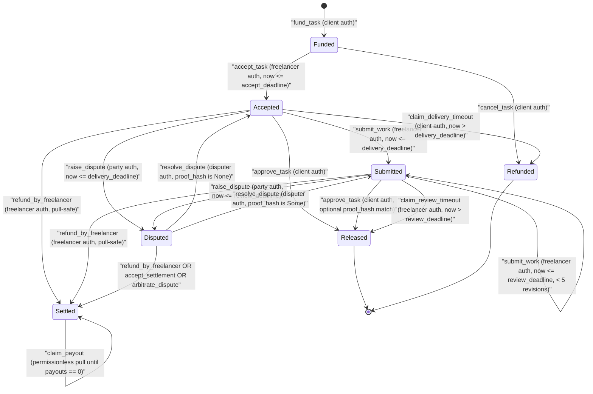

# GigPay Escrow Contract v2 Architecture and Security Specification

> [!IMPORTANT]
> Status: Proposed Specification (Not Implemented or Deployed).
> This document defines the proposed architecture, on-chain state machine, security controls, and migration plan for GigPay Escrow Contract v2 and its supporting application changes. No v2 Soroban contract code has been implemented or deployed. Any contract implementation or deployment requires formal approval under a revised Statement of Work (SOW) and sign-off from the Chapter Lead. The live Testnet v1 contract (`CAUU2O5Z3XPYEXPS4RNHSEEROBCF3BNUFLFL5XRCPAISV3B56SOB7RD3`, `contracts/gigpay_escrow/src/lib.rs`, commit `ebb2a7a`) remains unchanged.

---

## 1. Purpose, Scope, and Non-Goals

### 1.1 Background and v1 Baseline

GigPay v1 runs on Stellar Testnet with `soroban-sdk` 22.0.8 (`Cargo.lock`: 22.0.11). Its deployed contract exposes three entrypoints (`fund_task`, `approve_task`, and `get_task`) with `admin: null` and WASM hash `ea681b9739ada34e82b3d60158fb5fa75418e315488ee74074ce57b1180afdea`. While v1 guarantees that only the funding client can release funds to the named freelancer, six architectural and security limits block scale and production readiness:

1. Every `Task` struct and `TaskCounter` lives inside a single `env.storage().instance()` ledger entry (14,676 bytes at 46 escrows against the 65,536-byte network limit; 75 escrows on Nov 17, 2026 left room for roughly 130 more). Reaching the cap bricks `fund_task`, `approve_task`, and `get_task`. The contract never calls `extend_ttl()`, relying on manual runs of `scripts/extend_contract_ttl.mjs` (extended until roughly May 4, 2027).
2. The dispute freeze documented in [docs/DISPUTE_RESOLUTION.md](DISPUTE_RESOLUTION.md) is enforced only by the GigPay frontend and the PostgreSQL `enforce_task_update` trigger (THREAT-09). A client keyholder can invoke `approve_task` directly via Stellar Lab or the CLI while a dispute is open. Abandoned or deadlocked escrows lock tokens permanently because no cancel, timeout, or refund entrypoint exists.
3. On-chain `fund_task` does not reject `amount <= 0`, `client == freelancer` (enforced only in `src/lib/stellar.js` and `enforce_task_insert()` in Postgres, not on-chain; THREAT-02), untrusted token contract addresses, or self-contract party addresses. While `contracts/gigpay_escrow/Cargo.toml` sets `overflow-checks = true` in `[profile.release]` (so `u32` counter addition traps instead of wrapping), v1 lacks a typed error and `u64` capacity.
4. No structured contract events are emitted. Off-chain indexing (`scripts/index_escrows.mjs`) loops `get_task(1..N)` via RPC simulation and scans Horizon operations for every client account, which scales linearly and cannot index `C...` smart-wallet clients.
5. Testnet practice wallets keep raw `S...` keys in `localStorage` and sign transactions without a signing confirmation screen or key export flow (THREAT-10).
6. Permissive `SELECT` policies on `public.tasks` and `public.profiles` expose non-chain metadata (`submission_notes`, deliverable URLs, `dispute_reason`, profile fields) to unauthenticated and non-party reads, and task claims in Supabase do not verify cryptographic ownership of `freelancer_wallet` (THREAT-08).

### 1.2 In-Scope Objectives

- Replace shared `instance()` escrow storage with per-escrow `persistent()` entries and dynamic TTL management.
- Move the escrow lifecycle, dispute freeze, cancellation, timeout recovery, and pull-safe settlement splits on-chain with strict Checks-Effects-Interactions (CEI) ordering.
- Enforce minimum positive amounts, distinct valid parties, allowlisted 7-decimal SAC tokens, bounded deadlines, balance-delta verification, and atomic Protocol 22 `__constructor` initialization on-chain.
- Emit typed `#[contracttype]` Soroban contract events for cursor-based off-chain indexing.
- Define Testnet practice-wallet hardening, Mainnet signing boundaries, cryptographic wallet ownership binding, RLS privacy separation, `service_role`-verified v2 DB state transitions, and dual-contract coexistence with v1.

### 1.3 Explicit Non-Goals

- Modifying, upgrading, or migrating locked funds out of the deployed v1 contract `CAUU2O5Z3XPYEXPS4RNHSEEROBCF3BNUFLFL5XRCPAISV3B56SOB7RD3`.
- Introducing unilateral platform custody, admin fund seizure, or admin-controlled WASM upgrades over user escrows.
- Building a fee-sponsoring relayer for active `C...` Passkey/WebAuthn transaction submission in v2.0 (contract ABI, DB schema, indexer, and read/payout paths support `C...` addresses from day one; active `C...` fee-sponsored signing is scoped as a separate pre-Mainnet workstream).
- Implementing fiat on/off-ramps (GCash, bank transfers), marketplace discovery, ratings, or native mobile applications.
- Authorizing a Stellar Mainnet deployment without an independent third-party security audit and formal governance sign-off.

---

## 2. Storage Architecture and TTL Lifecycle

### 2.1 Storage Layout

Contract v2 separates constant-size global configuration from unbounded per-escrow records:

| Storage Tier | Key | Value Type | Estimated Size | Purpose |
| :--- | :--- | :--- | :--- | :--- |
| `instance()` | `DataKey::Config` | `ContractConfig` | Under 2 KB (`allowed_tokens` capped at 16 entries) | Contract version, optional non-custodial config admin and pending admin, pause flag for new escrows, minimum escrow amount, allowlisted token addresses |
| `instance()` | `DataKey::TaskCounter` | `u64` | 8 bytes | Monotonic escrow ID counter (`checked_add(1)`, capped at `MAX_TASK_ID`) |
| `persistent()` | `DataKey::Task(u64)` | `Task` | ~850 to 1,300 bytes (`ScMap` keyed by field symbols plus optional proposal and hashes) | Independent ledger entry per escrow |

Because `instance()` never stores per-escrow records and `allowed_tokens` is capped at `MAX_ALLOWED_TOKENS = 16`, instance storage stays below 2 KB regardless of escrow volume. Each escrow occupies its own `persistent()` ledger entry far below the 65,536-byte per-entry limit, eliminating the v1 ~205-escrow ceiling.

### 2.2 TTL Management Policy

Soroban `instance().extend_ttl(threshold, extend_to)` extends both the contract instance entry and the contract Wasm executable code entry. Each `persistent()` task entry tracks its own TTL independently.

Three `soroban-env-host` 22 (`22.1.3`) behaviors govern the TTL helper:

1. `Storage::extend_ttl(threshold, extend_to)` rejects `threshold > extend_to` with `(ScErrorType::Storage, ScErrorCode::InvalidInput)`. Both `extend_to` and `threshold` must therefore be clamped against `env.storage().max_ttl()` (available in `soroban-sdk` 22.0.8+).
2. `extend_ttl` is a lower-bound floor (`if new_live_until > old_live_until`) and never shortens an entry's existing remaining TTL.
3. Passing an unclamped `extend_to` risks `u32` addition overflow (`sequence + extend_to`), and on networks where `max_ttl()` is shorter than an escrow's 180-day delivery horizon, active tasks require periodic renewal or `RestoreFootprintOp` before execution.

```rust
const SECONDS_PER_LEDGER: u64 = 5;
const LEDGERS_PER_DAY: u32 = 17_280; // ~5 seconds per ledger

const INSTANCE_TTL_THRESHOLD: u32 = 14 * LEDGERS_PER_DAY;      // 241_920 ledgers (~14 days)
const INSTANCE_TTL_EXTEND_TO: u32 = 60 * LEDGERS_PER_DAY;      // 1_036_800 ledgers (~60 days)

const MIN_ACTIVE_TASK_TTL: u32 = 30 * LEDGERS_PER_DAY;         // 518_400 ledgers (~30 days)
const ACTIVE_TASK_TTL_THRESHOLD: u32 = 14 * LEDGERS_PER_DAY;   // 241_920 ledgers (~14 days)
const ACTIVE_TASK_BUFFER_LEDGERS: u32 = 14 * LEDGERS_PER_DAY;  // 241_920 ledgers (~14 days)

const TERMINAL_TASK_TTL_FLOOR: u32 = 14 * LEDGERS_PER_DAY;     // 241_920 ledgers (~14 days)

fn extend_instance_clamped(env: &Env, threshold: u32, target: u32) {
    let max_ttl = env.storage().max_ttl();
    let extend_to = target.min(max_ttl);
    let clamped_threshold = threshold.min(extend_to);
    env.storage().instance().extend_ttl(clamped_threshold, extend_to);
}

fn extend_task_clamped(env: &Env, key: &DataKey, threshold: u32, target: u32) {
    let max_ttl = env.storage().max_ttl();
    let extend_to = target.min(max_ttl);
    let clamped_threshold = threshold.min(extend_to);
    env.storage().persistent().extend_ttl(key, clamped_threshold, extend_to);
}

fn required_active_task_ttl(now: u64, end_timestamp: u64) -> u32 {
    let remaining_secs = end_timestamp.saturating_sub(now);
    let remaining_ledgers = (remaining_secs / SECONDS_PER_LEDGER).min(u32::MAX as u64) as u32;
    remaining_ledgers
        .saturating_add(ACTIVE_TASK_BUFFER_LEDGERS)
        .max(MIN_ACTIVE_TASK_TTL)
}
```

TTL rules across all entrypoints:

- `__constructor`, `set_token_allowed`, `set_funding_paused`, `propose_admin`, `accept_admin`, `renounce_admin`, and every escrow-mutating entrypoint call `extend_instance_clamped(env, INSTANCE_TTL_THRESHOLD, INSTANCE_TTL_EXTEND_TO)`.
- `fund_task` passes `threshold = extend_to` to `extend_task_clamped` using `required_active_task_ttl(now, delivery_deadline.saturating_add(review_window_secs))` so initial TTL dynamically covers up to 180-day schedules whenever network `max_ttl()` permits without overpaying rent on 1-day escrows.
- Horizon-extending and state-entering active mutations (`submit_work`, `raise_dispute`, `resolve_dispute`, `accept_settlement`, `arbitrate_dispute`, `refund_by_freelancer`) pass `threshold = required_ttl` (clamped to `extend_to`) so `extend_ttl` never no-ops when remaining TTL exceeds 14 days but falls short of the new deadline or 30-day claim horizon. Calling `extend_ttl(extend_to, extend_to)` is a zero-cost no-op when remaining TTL already meets `extend_to`. Exact `relevant_horizon` values are `delivery_deadline.saturating_add(review_window_secs)` for `Funded` and `Accepted`, `review_deadline` for `Submitted`, and `now` (hitting the 30-day `MIN_ACTIVE_TASK_TTL` floor) for `Disputed` and unclaimed `Settled` entries. Routine active transitions (`accept_task`, `propose_settlement`, and partial `claim_payout` where `client_payout > 0 || freelancer_payout > 0`) use `ACTIVE_TASK_TTL_THRESHOLD` with the same `relevant_horizon`.
- Finalized escrows (`approve_task`, `cancel_task`, `claim_delivery_timeout`, `claim_review_timeout`, and the final `claim_payout` where both `client_payout == 0 && freelancer_payout == 0`) are not deleted immediately. Each calls `extend_task_clamped(env, &key, TERMINAL_TASK_TTL_FLOOR, TERMINAL_TASK_TTL_FLOOR)` (passing `threshold == extend_to`) to guarantee at least 14 days of live readback even when remaining TTL was between 7 and 14 days. Because Soroban never shortens an existing TTL, a task closed early retains its remaining active TTL until natural archival, after which permanent history lives in indexed events (`public.escrow_events`).
- External keepers renew instance, Wasm, and long-lived active persistent entries using native Stellar `Operation.extendFootprintTtl` batches (avoiding WASM execution overhead). If an active persistent entry archives before renewal, clients execute `RestoreFootprintOp` using the `restorePreamble` returned by Soroban RPC simulation (Section 7).

---

## 3. Contract Data Model, Interface, and State Machine

### 3.1 Core Rust Types (`soroban-sdk` 22)

```rust
#![no_std]
use soroban_sdk::{contracterror, contracttype, Address, BytesN, Vec};

pub const CONTRACT_VERSION: u32 = 2;
pub const MAX_TASK_ID: u64 = i64::MAX as u64; // Matches PostgreSQL bigint upper bound (9.22e18)
pub const MAX_ALLOWED_TOKENS: u32 = 16;
pub const MAX_DISPUTES_PER_PARTY: u32 = 3;
pub const MAX_PROOF_REVISIONS: u32 = 5;

pub const MIN_ACCEPT_WINDOW_SECS: u64 = 3_600;           // 1 hour
pub const MAX_ACCEPT_WINDOW_SECS: u64 = 2_592_000;       // 30 days
pub const MIN_DELIVERY_WINDOW_SECS: u64 = 3_600;         // 1 hour after accept_deadline
pub const MAX_DELIVERY_WINDOW_SECS: u64 = 15_552_000;    // 180 days from funded_at
pub const MIN_REVIEW_WINDOW_SECS: u64 = 259_200;         // 3 days
pub const MAX_REVIEW_WINDOW_SECS: u64 = 2_592_000;       // 30 days
pub const RESUME_DELIVERY_GRACE_SECS: u64 = 259_200;     // 3 days minimum after client unfreeze in Accepted
pub const RESUME_REVIEW_GRACE_SECS: u64 = 259_200;       // 3 days minimum after unfreeze in Submitted
pub const DISPUTE_ESCALATION_DELAY_SECS: u64 = 259_200;  // 72 hours before opt-in arbitration

#[contracttype]
#[derive(Clone, Debug, Eq, PartialEq)]
pub enum DataKey {
    Config,
    TaskCounter,
    Task(u64),
}

#[contracttype]
#[derive(Clone, Debug, Eq, PartialEq)]
pub struct ContractConfig {
    pub version: u32,
    pub admin: Option<Address>,
    pub pending_admin: Option<Address>,
    pub funding_paused: bool,
    pub min_escrow_amount: i128, // Default 1_000_000 base units (0.1 unit on 7-decimal SACs)
    pub allowed_tokens: Vec<Address>,
}

#[contracttype]
#[derive(Clone, Copy, Debug, Eq, PartialEq)]
#[repr(u32)]
pub enum TaskStatus {
    Funded = 0,
    Accepted = 1,
    Submitted = 2,
    Disputed = 3,
    Released = 4,
    Refunded = 5,
    Settled = 6,
}

#[contracttype]
#[derive(Clone, Copy, Debug, Eq, PartialEq)]
#[repr(u32)]
pub enum ReleaseReason {
    ClientApproved = 0,
    ReviewTimeout = 1,
}

#[contracttype]
#[derive(Clone, Copy, Debug, Eq, PartialEq)]
#[repr(u32)]
pub enum RefundReason {
    Cancelled = 0,
    DeliveryTimeout = 1,
}

#[contracttype]
#[derive(Clone, Copy, Debug, Eq, PartialEq)]
#[repr(u32)]
pub enum SettlementReason {
    FreelancerRefund = 0,
    MutualAgreement = 1,
    ArbitrationRuling = 2,
}

#[contracttype]
#[derive(Clone, Debug, Eq, PartialEq)]
pub struct SettlementProposal {
    pub proposer: Address,
    pub client_amount: i128,
    pub freelancer_amount: i128,
    pub nonce: u32,
}

#[contracttype]
#[derive(Clone, Debug, Eq, PartialEq)]
pub struct Task {
    pub id: u64,
    pub client: Address,
    pub freelancer: Address,
    pub arbitrator: Option<Address>,
    pub token: Address,
    pub amount: i128,
    pub status: TaskStatus,
    pub funded_at: u64,
    pub accept_deadline: u64,
    pub delivery_deadline: u64,
    pub review_window_secs: u64,
    pub accepted_at: Option<u64>,
    pub submitted_at: Option<u64>,
    pub review_deadline: Option<u64>,
    pub remaining_review_secs: Option<u64>,
    pub proof_hash: Option<BytesN<32>>,
    pub revision_count: u32,
    pub disputed_by: Option<Address>,
    pub disputed_at: Option<u64>,
    pub dispute_reason_hash: Option<BytesN<32>>,
    pub client_dispute_count: u32,
    pub freelancer_dispute_count: u32,
    pub proposal_nonce: u32,
    pub proposal: Option<SettlementProposal>,
    pub ruling_hash: Option<BytesN<32>>,
    pub client_payout: i128,
    pub freelancer_payout: i128,
    pub settled_at: Option<u64>,
}

#[contracterror]
#[derive(Copy, Clone, Debug, Eq, PartialEq, PartialOrd, Ord)]
#[repr(u32)]
pub enum EscrowError {
    Unauthorized = 1,
    FundingPaused = 2,
    InvalidAmount = 3,
    AmountBelowMinimum = 4,
    SelfDealingNotAllowed = 5,
    InvalidPartyAddress = 6,
    TokenNotAllowed = 7,
    InvalidToken = 8,
    EmptyAllowlist = 9,
    TokenAllowlistFull = 10,
    InvalidAdmin = 11,
    PendingAdminMissing = 12,
    InvalidArbitrator = 13,
    InvalidDeadline = 14,
    InvalidReviewWindow = 15,
    CounterOverflow = 16,
    UnsupportedTokenBehavior = 17,
    TaskNotFound = 18,
    InvalidState = 19,
    TaskDisputed = 20,
    DeadlineExpired = 21,
    DeadlineNotReached = 22,
    MaxRevisionsReached = 23,
    ProofHashMismatch = 24,
    MaxDisputesReached = 25,
    InvalidSplit = 26,
    NoActiveProposal = 27,
    ProposalMismatch = 28,
    ArbitrationNotEnabled = 29,
    EscalationDelayNotElapsed = 30,
    NothingToClaim = 31,
}
```

All `Task` fields total 28 entries (within the 40-field `#[contracttype]` limit in `soroban-sdk-macros` 22.0.11) and all field names stay at or below 24 characters (within the 30-character symbol limit).

### 3.2 State Machine Transitions



### 3.3 Entrypoint Signatures, Authorization, and Failure Rules

Every entrypoint executes state and membership validation before or alongside `require_auth()` as specified below so invalid calls return typed `EscrowError` variants consistently. All timestamps use `env.ledger().timestamp()` (`u64` UNIX seconds).

#### `__constructor(env: Env, admin: Option<Address>, allowed_tokens: Vec<Address>, min_escrow_amount: i128) -> Result<(), EscrowError>`
- Authorization: atomic Protocol 22 deployment transaction (not callable post-deploy and omitted from generated `Client`). Under `soroban-env-host` 22, constructor errors wrap into `Error(Context, InvalidAction)`.
- Checks: `min_escrow_amount > 0` (`InvalidAmount`), `1 <= allowed_tokens.len() <= MAX_ALLOWED_TOKENS` (`EmptyAllowlist` / `TokenAllowlistFull`), no token equals `env.current_contract_address()` (`InvalidToken`), if `admin == Some(addr)` then `addr != env.current_contract_address()` (`InvalidAdmin`), deduplicates `allowed_tokens`.
- Effects: stores `ContractConfig` and `TaskCounter = 0u64` in `instance()`, calls `extend_instance_clamped`.

#### `fund_task(env: Env, client: Address, freelancer: Address, token: Address, amount: i128, accept_deadline: u64, delivery_deadline: u64, review_window_secs: u64, arbitrator: Option<Address>) -> Result<u64, EscrowError>`
- Authorization: `client.require_auth()` after pure input validation.
- Checks: `!config.funding_paused` (`FundingPaused`); `amount > 0` (`InvalidAmount`); `amount >= config.min_escrow_amount` (`AmountBelowMinimum`); `client != freelancer` (`SelfDealingNotAllowed`); `client != self_addr && freelancer != self_addr` (`InvalidPartyAddress`); `config.allowed_tokens.contains(&token)` (`TokenNotAllowed`); if `arbitrator == Some(a)` then `a != client && a != freelancer && a != self_addr` (`InvalidArbitrator`); `now + MIN_ACCEPT_WINDOW_SECS <= accept_deadline <= now + MAX_ACCEPT_WINDOW_SECS` (`InvalidDeadline`); `accept_deadline + MIN_DELIVERY_WINDOW_SECS <= delivery_deadline <= now + MAX_DELIVERY_WINDOW_SECS` (`InvalidDeadline`); `MIN_REVIEW_WINDOW_SECS <= review_window_secs <= MAX_REVIEW_WINDOW_SECS` (`InvalidReviewWindow`); `next_id = counter.checked_add(1)` and `next_id <= MAX_TASK_ID` (`CounterOverflow`).
- Effects (CEI order): records `bal_before = token_client.balance(&self_addr)`, writes `TaskCounter = next_id` to `instance()`, writes new `Task` (`status = Funded`) to `persistent()`, extends instance and dynamic task TTLs, emits `funded`, calls `token_client.transfer(&client, &self_addr, &amount)`, then verifies `token_client.balance(&self_addr).checked_sub(bal_before) == Some(amount)` (`UnsupportedTokenBehavior`). Because Soroban reverts all storage writes atomically on error/trap, persisting before `transfer` prevents reentrancy ID collisions without risking ghost records.

#### `cancel_task(env: Env, task_id: u64) -> Result<(), EscrowError>`
- Authorization: `task.client.require_auth()`.
- Checks: task exists (`TaskNotFound`); `status == Funded` (`InvalidState`). Permanently disabled once accepted.
- Effects (CEI order): sets `status = Refunded`, `settled_at = Some(now)`, persists to `persistent()`, applies instance and terminal task TTL, emits `refunded` (`RefundReason::Cancelled`), transfers `amount` from contract to `task.client`.

#### `accept_task(env: Env, task_id: u64) -> Result<(), EscrowError>`
- Authorization: `task.freelancer.require_auth()`.
- Checks: task exists (`TaskNotFound`); `status == Funded` (`InvalidState`); `now <= task.accept_deadline` (`DeadlineExpired`).
- Effects: sets `status = Accepted`, `accepted_at = Some(now)`, persists, extends instance and active task TTLs, emits `accepted`.

#### `submit_work(env: Env, task_id: u64, proof_hash: BytesN<32>) -> Result<(), EscrowError>`
- Authorization: `task.freelancer.require_auth()`.
- Checks: task exists (`TaskNotFound`); if `status == Disputed` returns `TaskDisputed`; requires `status == Accepted || status == Submitted` (`InvalidState`); when `status == Accepted` requires `now <= task.delivery_deadline` (`DeadlineExpired`); when `status == Submitted` requires `now <= task.review_deadline.unwrap()` (`DeadlineExpired`) and `task.revision_count < MAX_PROOF_REVISIONS` (`MaxRevisionsReached`), allowing post-dispute deliverable revisions even if `delivery_deadline` elapsed during review while bounding revisions to 5.
- Effects: increments `revision_count` (`checked_add(1)`), sets `proof_hash = Some(proof_hash)`, `submitted_at = Some(now)`, `review_deadline = Some(now.saturating_add(task.review_window_secs))`, `status = Submitted`, persists, extends instance and active task TTLs (`threshold = required_ttl`), emits `submitted`.

#### `approve_task(env: Env, task_id: u64, expected_proof_hash: Option<BytesN<32>>) -> Result<(), EscrowError>`
- Authorization: `task.client.require_auth()`.
- Checks: task exists (`TaskNotFound`); if `status == Disputed` returns `TaskDisputed` (closes THREAT-09); requires `status == Accepted || status == Submitted` (`InvalidState`); if `expected_proof_hash.is_some()` requires `task.proof_hash == expected_proof_hash` (`ProofHashMismatch`, preventing deliverable front-running).
- Effects (CEI order): sets `status = Released`, `settled_at = Some(now)`, `remaining_review_secs = None`, persists, applies instance and terminal task TTL, emits `released` (`ReleaseReason::ClientApproved`, `task.proof_hash`), transfers `amount` from contract to `task.freelancer`.

#### `claim_delivery_timeout(env: Env, task_id: u64) -> Result<(), EscrowError>`
- Authorization: `task.client.require_auth()`.
- Checks: task exists (`TaskNotFound`); if `status == Disputed` returns `TaskDisputed`; requires `status == Accepted` (`InvalidState`); requires `now > task.delivery_deadline` (`DeadlineNotReached`).
- Effects (CEI order): sets `status = Refunded`, `settled_at = Some(now)`, persists, applies instance and terminal task TTL, emits `refunded` (`RefundReason::DeliveryTimeout`), transfers `amount` from contract to `task.client`.

#### `claim_review_timeout(env: Env, task_id: u64) -> Result<(), EscrowError>`
- Authorization: `task.freelancer.require_auth()`.
- Checks: task exists (`TaskNotFound`); if `status == Disputed` returns `TaskDisputed`; requires `status == Submitted` (`InvalidState`); requires `now > task.review_deadline.unwrap()` (`DeadlineNotReached`).
- Effects (CEI order): sets `status = Released`, `settled_at = Some(now)`, `remaining_review_secs = None`, persists, applies instance and terminal task TTL, emits `released` (`ReleaseReason::ReviewTimeout`, `task.proof_hash`), transfers `amount` from contract to `task.freelancer`.

#### `refund_by_freelancer(env: Env, task_id: u64) -> Result<(), EscrowError>`
- Authorization: `task.freelancer.require_auth()`.
- Checks: task exists (`TaskNotFound`); requires `status == Accepted || status == Submitted || status == Disputed` (`InvalidState`).
- Effects: transitions to pull-safe `status = Settled` with `client_payout = task.amount`, `freelancer_payout = 0`, `settled_at = Some(now)`, clears `proposal = None` and `remaining_review_secs = None`, retains historical dispute metadata (`disputed_by`, `disputed_at`, `dispute_reason_hash`), persists, extends instance and active task TTLs, emits `settled` (`SettlementReason::FreelancerRefund`, `ruling_hash = None`). Client withdraws via `claim_payout`, preventing trustline/account-merge DoS from blocking a voluntary refund.

#### `raise_dispute(env: Env, task_id: u64, caller: Address, reason_hash: BytesN<32>) -> Result<(), EscrowError>`
- Authorization: validates `caller == task.client || caller == task.freelancer` (`Unauthorized`), then `caller.require_auth()`.
- Checks: task exists (`TaskNotFound`); if `status == Disputed` returns `TaskDisputed`; requires `status == Accepted || status == Submitted` (`InvalidState`); if `status == Accepted` requires `now <= task.delivery_deadline` (`DeadlineExpired`); if `status == Submitted` requires `now <= task.review_deadline.unwrap()` (`DeadlineExpired`); checks caller-specific quota (`client_dispute_count < MAX_DISPUTES_PER_PARTY` when `caller == client`, or `freelancer_dispute_count < MAX_DISPUTES_PER_PARTY` when `caller == freelancer`; otherwise `MaxDisputesReached`).
- Effects: increments only the caller's dispute counter; if `status == Submitted`, saves `remaining_review_secs = Some(task.review_deadline.unwrap().saturating_sub(now))`; sets `status = Disputed`, `disputed_by = Some(caller)`, `disputed_at = Some(now)`, `dispute_reason_hash = Some(reason_hash)`, clears `proposal = None` (without touching `proposal_nonce`), persists, extends instance and active task TTLs, emits `disputed`.

#### `resolve_dispute(env: Env, task_id: u64) -> Result<(), EscrowError>`
- Authorization: `disputer.require_auth()` where `disputer = task.disputed_by.clone().ok_or(EscrowError::InvalidState)?`. (Only the party who raised the active dispute may unilaterally withdraw it; mutual exits use `propose_settlement` + `accept_settlement`.)
- Checks: task exists (`TaskNotFound`); requires `status == Disputed` (`InvalidState`).
- Effects: captures `disputed_at = task.disputed_at.unwrap()`, clears `proposal = None`, `disputed_by = None`, `disputed_at = None`, `dispute_reason_hash = None`, and calculates the resumed state deterministically from `task.proof_hash.is_some()`:
  - When `task.proof_hash.is_none()` (resuming to `Accepted`): if `disputer == task.client`, preserves all unused delivery time (`remaining_delivery = task.delivery_deadline.saturating_sub(disputed_at)`) and sets `delivery_deadline = now.saturating_add(remaining_delivery.max(RESUME_DELIVERY_GRACE_SECS))`, preventing a client from holding a dispute long enough to compress a long delivery window. If `disputer == task.freelancer`, `delivery_deadline` is left unchanged so a freelancer cannot pause their own delivery clock.
  - When `task.proof_hash.is_some()` (resuming to `Submitted`): reads `remaining = task.remaining_review_secs.unwrap_or(0)`, clears `remaining_review_secs = None`, and sets `review_deadline = Some(now.saturating_add(remaining.max(RESUME_REVIEW_GRACE_SECS)))`. Because `remaining` is preserved in full and floored at 3 days, neither party can truncate the other's review window.
  - Persists, extends instance and active task TTLs (`threshold = required_ttl`), emits `resolved`.

#### `propose_settlement(env: Env, task_id: u64, proposer: Address, client_amount: i128, freelancer_amount: i128) -> Result<u32, EscrowError>`
- Authorization: validates `proposer == task.client || proposer == task.freelancer` (`Unauthorized`), then `proposer.require_auth()`.
- Checks: task exists (`TaskNotFound`); requires `status == Disputed` (`InvalidState`); requires `client_amount >= 0 && freelancer_amount >= 0 && client_amount.checked_add(freelancer_amount) == Some(task.amount)` (`InvalidSplit`); `next_nonce = task.proposal_nonce.checked_add(1).ok_or(EscrowError::CounterOverflow)?`.
- Effects: sets `task.proposal_nonce = next_nonce`, replaces `task.proposal = Some(SettlementProposal { proposer, client_amount, freelancer_amount, nonce: next_nonce })`, persists, extends instance and active task TTLs, emits `proposed`, returns `next_nonce`. Because `proposal_nonce` lives on `Task` and never resets across dispute cycles, stale auth entries or events never collide.

#### `accept_settlement(env: Env, task_id: u64, acceptor: Address, expected_nonce: u32, expected_client_amount: i128, expected_freelancer_amount: i128) -> Result<(), EscrowError>`
- Authorization: loads task (`TaskNotFound`), requires `status == Disputed` (`InvalidState`), loads `proposal = task.proposal.ok_or(EscrowError::NoActiveProposal)?`, validates `acceptor == task.client || acceptor == task.freelancer` and `acceptor != proposal.proposer` (`Unauthorized`), then `acceptor.require_auth()`.
- Checks: verifies `proposal.nonce == expected_nonce && proposal.client_amount == expected_client_amount && proposal.freelancer_amount == expected_freelancer_amount` (`ProposalMismatch`, blocking mempool replacement front-running).
- Effects: transitions unconditionally to pull-safe `status = Settled` with `client_payout = proposal.client_amount`, `freelancer_payout = proposal.freelancer_amount`, `settled_at = Some(now)`, `proposal = None`, `remaining_review_secs = None`, retains historical dispute metadata (`disputed_by`, `disputed_at`, `dispute_reason_hash`), persists, extends instance and active task TTLs (`threshold = required_ttl`), emits `settled` (`SettlementReason::MutualAgreement`, `ruling_hash = None`).

#### `arbitrate_dispute(env: Env, task_id: u64, client_amount: i128, freelancer_amount: i128, ruling_hash: BytesN<32>) -> Result<(), EscrowError>`
- Authorization: loads task (`TaskNotFound`), loads `arbitrator = task.arbitrator.ok_or(EscrowError::ArbitrationNotEnabled)?`, then `arbitrator.require_auth()`.
- Checks: requires `status == Disputed` (`InvalidState`); requires `now >= task.disputed_at.unwrap().saturating_add(DISPUTE_ESCALATION_DELAY_SECS)` (`EscalationDelayNotElapsed`); requires `client_amount >= 0 && freelancer_amount >= 0 && client_amount.checked_add(freelancer_amount) == Some(task.amount)` (`InvalidSplit`).
- Effects: transitions unconditionally to pull-safe `status = Settled` with `client_payout = client_amount`, `freelancer_payout = freelancer_amount`, `ruling_hash = Some(ruling_hash)`, `settled_at = Some(now)`, `proposal = None`, `remaining_review_secs = None`, retains historical dispute metadata (`disputed_by`, `disputed_at`, `dispute_reason_hash`), persists, extends instance and active task TTLs (`threshold = required_ttl`), emits `settled` (`SettlementReason::ArbitrationRuling`, `ruling_hash = Some(ruling_hash)`).

#### `claim_payout(env: Env, task_id: u64, recipient: Address) -> Result<i128, EscrowError>`
- Authorization: none (permissionless pull restricted to fixed `task.client` or `task.freelancer` stored on `Task`).
- Checks: task exists (`TaskNotFound`); requires `status == Settled` (`InvalidState`); validates `recipient == task.client || recipient == task.freelancer` (`Unauthorized`); checks matching `*_payout > 0` (`NothingToClaim`).
- Effects (CEI order): captures `payout`, sets matching `*_payout = 0`, persists to `persistent()`, applies terminal TTL if `client_payout == 0 && freelancer_payout == 0` (otherwise active TTL), extends instance TTL, emits `claimed`, then calls `token_client.transfer(&self_addr, &recipient, &payout)`.

#### Read-Only and Operational Admin Entrypoints

| Entrypoint | Arguments | Required Auth | Failure Conditions and Effects |
| :--- | :--- | :--- | :--- |
| `get_task` | `(task_id: u64) -> Result<Task, EscrowError>` | None | Returns `TaskNotFound` instead of trapping on `unwrap()`. |
| `get_config` | `() -> ContractConfig` | None | Returns `DataKey::Config` from `instance()`. |
| `set_token_allowed` | `(token: Address, allowed: bool) -> Result<(), EscrowError>` | `config.admin` (`Unauthorized` if `None`) | Rejects `token == self_addr` (`InvalidToken`). When `allowed == true`, no-ops cleanly if already present, else rejects if `len >= MAX_ALLOWED_TOKENS` (`TokenAllowlistFull`). When `allowed == false`, no-ops cleanly if not present, else rejects if removing would leave `allowed_tokens` empty (`EmptyAllowlist`). Affects future `fund_task` calls only; bumps instance TTL; emits `tokens`. |
| `set_funding_paused` | `(paused: bool) -> Result<(), EscrowError>` | `config.admin` (`Unauthorized` if `None`) | Pauses/resumes new `fund_task` calls only; never blocks lifecycle completion, disputes, settlements, or claims on existing escrows. Bumps instance TTL; emits `paused`. |
| `propose_admin` | `(new_admin: Address) -> Result<(), EscrowError>` | `config.admin` (`Unauthorized` if `None`) | Rejects `new_admin == self_addr` (`InvalidAdmin`). Sets `config.pending_admin = Some(new_admin)`, bumps instance TTL, emits `admin`. |
| `accept_admin` | `() -> Result<(), EscrowError>` | `config.pending_admin` (`PendingAdminMissing` if `None`) | Promotes `pending_admin` to `admin`, clears `pending_admin`, bumps instance TTL, emits `admin`. |
| `renounce_admin` | `() -> Result<(), EscrowError>` | `config.admin` (`Unauthorized` if `None`) | Sets `admin = None` and `pending_admin = None` permanently, bumps instance TTL, emits `admin`. |

### 3.4 Pull-Safe Payout Design and Trustline DoS Prevention

On Stellar, `token.transfer(contract, recipient, amount)` reverts the entire transaction if `recipient` lacks a trustline for a non-native SAC (such as USDC), has a frozen or limit-exceeded trustline, or has merged their account.

To prevent trustline or account-merge griefing from blocking rulings, mutual agreements, or voluntary refunds:

- All `accept_settlement`, `arbitrate_dispute`, and `refund_by_freelancer` calls settle unconditionally into `TaskStatus::Settled` (even when one side receives 100% and the other receives 0%) without performing an inline token transfer. Each entitled party (or a relayer) pulls funds independently via `claim_payout(task_id, recipient)`. A missing trustline or merged account on one side can never block the arbitrator's ruling or the counterparty's payout.
- Direct-push happy paths (`approve_task`, `cancel_task`, `claim_delivery_timeout`, `claim_review_timeout`) pay the sole recipient in a single transaction for minimal UX friction. If a direct push fails due to a missing trustline, the recipient adds the trustline and the caller retries (the frontend also checks recipient trustline presence and limit before `fund_task` and `accept_task` for non-native SACs).

### 3.5 Dispute Resolution Trust Model and Tradeoffs

Contract v2 supports two dispute modes chosen immutably at `fund_task` and displayed to the freelancer before `accept_task`:

1. Non-custodial two-party mode (`arbitrator: None`, mandatory default for Testnet pilot): no platform key or third party has any authority over locked funds. Disputes freeze `approve_task` and timeouts on-chain (`TaskDisputed`), and exits occur through `resolve_dispute`, `refund_by_freelancer`, or mutual `propose_settlement` + `accept_settlement`. If both parties refuse to settle or unfreeze, tokens stay locked in `Disputed` indefinitely, giving both sides economic incentive to negotiate rather than abandon funds.
2. Opt-in third-party arbitration mode (`arbitrator: Some(addr)`, deferred until governance approval): the named arbitrator has zero permissions unless `status == Disputed` and `DISPUTE_ESCALATION_DELAY_SECS` (72 hours) has elapsed since `disputed_at`. Rulings can split funds strictly between `task.client` and `task.freelancer` (`client_amount + freelancer_amount == task.amount`) and persist `ruling_hash` both on `Task` and in the `settled` event. Production arbitrators must be Stellar multisig accounts or Soroban multisig smart wallets (such as 2-of-3 or 3-of-5 independent reviewers), never single hot keys. Collusion between an opted-in arbitrator and one party remains a residual trust risk accepted explicitly at funding and acceptance time.

### 3.6 Governance and Upgradeability Policy

Contract v2 deploys as immutable bytecode with versioned parallel deployments and intentionally omits `env.deployer().update_current_contract_wasm(...)`. An admin-controlled WASM upgrade entrypoint would allow a compromised admin key to swap bytecode and drain every locked escrow in one transaction.

- Any deployment relying on `set_funding_paused(true)` for incident response or deprecation must configure a non-`None` multisig `admin`. Single-asset immutable pilots with no on-chain pause requirement may deploy with `admin: None` (relying on frontend funding disablement for deprecation).
- `admin` has zero privileges to move funds, alter existing tasks, resolve disputes, or pause completion of in-flight escrows.
- Future breaking upgrades (v3) deploy under a new contract ID; `set_funding_paused(true)` halts new escrows on the older contract while all existing escrows finish normally.
- A timelocked multisig `upgrade` entrypoint was rejected because escrows spanning up to 180 days would still be exposed to governance takeover across shorter timelocks and users would have to monitor upgrade announcements.

### 3.7 Token Allowlist and Security Invariants

- All outgoing transfers and `fund_task` persist storage updates before calling `token_client.transfer(...)` (full CEI ordering).
- `fund_task` checks `balance_after - balance_before == amount`, rejecting fee-on-transfer or rebasing SEP-41 tokens. Governance policy further restricts `allowed_tokens` strictly to standard 7-decimal Classic SACs without `AUTH_CLAWBACK_ENABLED` so pooled contract balances remain solvent across concurrent escrows.
- Dispute quotas are tracked independently per party (`client_dispute_count`, `freelancer_dispute_count <= 3`), post-deadline `raise_dispute` calls reject with `DeadlineExpired`, freelancer disputes never extend `delivery_deadline`, and resuming from `Disputed -> Submitted` preserves `remaining_review_secs` with a 3-day floor.
- Only `BytesN<32>` SHA-256 commitments (`proof_hash`, `dispute_reason_hash`, `ruling_hash`) are stored on-chain; human-readable deliverables and dispute prose stay off-chain in RLS-protected storage. Canonical preimages are defined deterministically so off-chain records can be verified against on-chain commitments: `dispute_reason_hash = SHA-256(UTF-8(trim(dispute_reason)))` and `proof_hash = SHA-256(canonical sorted-key JSON of { "doc_url": ..., "github_pr_url": ..., "loom_url": ..., "submission_notes": ... } with trimmed strings and explicit nulls)`.
- `Cargo.toml` retains `overflow-checks = true` in `[profile.release]`, and all arithmetic uses checked or saturating operations.

---

## 4. Contract Events and Indexing Architecture

### 4.1 Typed Event Schema (`#[contracttype]`)

Contract v2 publishes events via `env.events().publish(topics, payload)` where every topic symbol is 9 ASCII characters or fewer (`symbol_short!`) and every payload is a named `#[contracttype]` struct (encoding deterministically as `ScVal::Map` and exported in `contractspecv0`):

```rust
#[contracttype]
#[derive(Clone, Debug, Eq, PartialEq)]
pub struct TaskFundedEvent {
    pub client: Address,
    pub freelancer: Address,
    pub token: Address,
    pub amount: i128,
    pub funded_at: u64,
    pub accept_deadline: u64,
    pub delivery_deadline: u64,
    pub review_window_secs: u64,
    pub arbitrator: Option<Address>,
}

#[contracttype]
#[derive(Clone, Debug, Eq, PartialEq)]
pub struct TaskAcceptedEvent {
    pub freelancer: Address,
    pub accepted_at: u64,
}

#[contracttype]
#[derive(Clone, Debug, Eq, PartialEq)]
pub struct TaskSubmittedEvent {
    pub freelancer: Address,
    pub proof_hash: BytesN<32>,
    pub revision_count: u32,
    pub submitted_at: u64,
    pub review_deadline: u64,
}

#[contracttype]
#[derive(Clone, Debug, Eq, PartialEq)]
pub struct TaskDisputedEvent {
    pub disputed_by: Address,
    pub reason_hash: BytesN<32>,
    pub client_dispute_count: u32,
    pub freelancer_dispute_count: u32,
    pub disputed_at: u64,
}

#[contracttype]
#[derive(Clone, Debug, Eq, PartialEq)]
pub struct TaskResolvedEvent {
    pub resolved_by: Address,
    pub resumed_status: TaskStatus,
    pub new_deadline: u64,
    pub resolved_at: u64,
}

#[contracttype]
#[derive(Clone, Debug, Eq, PartialEq)]
pub struct SettlementProposedEvent {
    pub proposer: Address,
    pub nonce: u32,
    pub client_amount: i128,
    pub freelancer_amount: i128,
}

#[contracttype]
#[derive(Clone, Debug, Eq, PartialEq)]
pub struct TaskSettledEvent {
    pub reason: SettlementReason,
    pub client_amount: i128,
    pub freelancer_amount: i128,
    pub ruling_hash: Option<BytesN<32>>,
    pub settled_at: u64,
}

#[contracttype]
#[derive(Clone, Debug, Eq, PartialEq)]
pub struct TaskReleasedEvent {
    pub reason: ReleaseReason,
    pub freelancer: Address,
    pub amount: i128,
    pub proof_hash: Option<BytesN<32>>,
    pub settled_at: u64,
}

#[contracttype]
#[derive(Clone, Debug, Eq, PartialEq)]
pub struct TaskRefundedEvent {
    pub reason: RefundReason,
    pub client: Address,
    pub amount: i128,
    pub settled_at: u64,
}

#[contracttype]
#[derive(Clone, Debug, Eq, PartialEq)]
pub struct PayoutClaimedEvent {
    pub recipient: Address,
    pub amount: i128,
    pub remaining_client: i128,
    pub remaining_freelancer: i128,
}

#[contracttype]
#[derive(Clone, Debug, Eq, PartialEq)]
pub struct TokenConfigEvent {
    pub token: Address,
    pub allowed: bool,
    pub updated_by: Address,
}

#[contracttype]
#[derive(Clone, Debug, Eq, PartialEq)]
pub struct PauseConfigEvent {
    pub paused: bool,
    pub updated_by: Address,
}

#[contracttype]
#[derive(Clone, Debug, Eq, PartialEq)]
pub struct AdminConfigEvent {
    pub admin: Option<Address>,
    pub pending_admin: Option<Address>,
    pub updated_by: Address,
}
```

| Event Topic Tuple | Payload Struct | Triggering Entrypoint(s) |
| :--- | :--- | :--- |
| `(symbol_short!("escrow"), symbol_short!("funded"), task_id)` | `TaskFundedEvent` | `fund_task` |
| `(symbol_short!("escrow"), symbol_short!("accepted"), task_id)` | `TaskAcceptedEvent` | `accept_task` |
| `(symbol_short!("escrow"), symbol_short!("submitted"), task_id)` | `TaskSubmittedEvent` | `submit_work` |
| `(symbol_short!("escrow"), symbol_short!("disputed"), task_id)` | `TaskDisputedEvent` | `raise_dispute` |
| `(symbol_short!("escrow"), symbol_short!("resolved"), task_id)` | `TaskResolvedEvent` | `resolve_dispute` |
| `(symbol_short!("escrow"), symbol_short!("proposed"), task_id)` | `SettlementProposedEvent` | `propose_settlement` |
| `(symbol_short!("escrow"), symbol_short!("settled"), task_id)` | `TaskSettledEvent` | `refund_by_freelancer`, `accept_settlement`, `arbitrate_dispute` |
| `(symbol_short!("escrow"), symbol_short!("released"), task_id)` | `TaskReleasedEvent` | `approve_task`, `claim_review_timeout` |
| `(symbol_short!("escrow"), symbol_short!("refunded"), task_id)` | `TaskRefundedEvent` | `cancel_task`, `claim_delivery_timeout` |
| `(symbol_short!("escrow"), symbol_short!("claimed"), task_id)` | `PayoutClaimedEvent` | `claim_payout` |
| `(symbol_short!("escrow"), symbol_short!("tokens"), token)` | `TokenConfigEvent` | `set_token_allowed` |
| `(symbol_short!("escrow"), symbol_short!("paused"))` | `PauseConfigEvent` | `set_funding_paused` |
| `(symbol_short!("escrow"), symbol_short!("admin"))` | `AdminConfigEvent` | `propose_admin`, `accept_admin`, `renounce_admin` |

### 4.2 Indexer Contract and RPC Retention Handling

Soroban RPC `getEvents` retains only a bounded rolling ledger window (typically 24 hours to 7 days depending on RPC provider). The v2 indexer handles retention, pagination, concurrency, and projection deterministically:

1. Deployment records `deploy_ledger` inside `deployments/testnet-v2.json`. On first run, `public.indexer_cursors` seeds `last_ledger_seq = deploy_ledger - 1` (never `startLedger: 1`, which fails RPC retention checks).
2. Each scheduled worker invocation (Supabase Edge Function cron or GitHub Actions schedule every 5 minutes) acquires a short-lived row lease on `public.indexer_cursors` via an atomic `UPDATE public.indexer_cursors SET lease_owner = $1, lease_expires_at = now() + interval '4 minutes' WHERE contract_id = $2 AND (lease_expires_at IS NULL OR lease_expires_at < now()) RETURNING *` (safe under PostgREST and Supavisor transaction pooling where session-level advisory locks fail). Overlapping runs exit cleanly without regressing cursors, and both cursor advancement and lease clearing (`SET lease_expires_at = NULL`) fence on `WHERE contract_id = $2 AND lease_owner = $1` so a delayed worker whose lease expired can never overwrite a successor's cursor or release a successor's lease.
3. Before polling, the worker calls `getHealth()` and compares `last_ledger_seq + 1` against `oldestLedger`. If a gap is detected, the worker raises an operational alert and halts cursor advancement until archive backfill (via Galexie, Stellar Hubble, or Mercury) fills the missing range.
4. The worker queries `getEvents` filtered by `contractIds: [V2_CONTRACT_ID]`, accepts only entries with `type === 'contract'` and `inSuccessfulContractCall === true`, and loops `cursor` until `events.length < limit`.
5. Each event is upserted into `public.escrow_events` deduplicated on `(contract_id, rpc_event_id)` (using Soroban RPC's globally unique `id` string rather than a synthetic offset), storing `on_chain_task_id = NULL` for contract-level config events (`tokens`, `paused`, `admin`), and projected atomically onto `public.tasks` via `service_role`. When projecting `accepted`, the worker resolves `tasks.freelancer_id` from `profiles.verified_wallet_address = event.freelancer`.
6. After draining a poll cycle (including zero-event polls), the worker updates `last_ledger_seq = response.latestLedger` and clears `last_paging_token = null`, preventing stale paging tokens from expiring across quiet periods.
7. Because events emit `(client, freelancer)` directly from contract execution, `C...` smart-wallet addresses index identically to `G...` accounts, resolving the `isAccountKey` limitation in `scripts/index_escrows.mjs`.

---

## 5. Wallet Signing, Key Management, and Identity Binding

### 5.1 Testnet vs. Mainnet Signing Boundary (Closing THREAT-10)

| Capability | Local / Standalone | Stellar Testnet Pilot | Stellar Mainnet (Future) |
| :--- | :--- | :--- | :--- |
| Browser practice wallet (`localStorage` / `sessionStorage` keypair) | Allowed via confirmation modal | Allowed via confirmation modal and key export | Hard-blocked at build time and runtime; `isEphemeralSignerAllowed` checks both `NETWORK` and `STELLAR_NETWORK_PASSPHRASE !== Networks.PUBLIC` and fails closed |
| Varial (formerly Freighter) / Stellar Wallets Kit (`G...`) | Supported | Supported | Supported (primary signing path) |
| Passkey / WebAuthn Soroban Smart Wallet (`C...`) | Contract/DB/indexer compatible; active signing deferred to Relayer spec | Contract/DB/indexer compatible; active signing deferred to Relayer spec | Recommended extensionless path once separate Fee-Sponsoring Relayer and SEP-45 spec is built and audited |
| `fund-practice-wallet` pool Edge Function | Allowed (local Quickstart only) | Allowed (hardened per Section 6.4) | Removed and never deployed |

Note on `C...` smart-wallet architecture: on Stellar, a `C...` contract address cannot serve as an outer transaction `sourceAccount` or pay native XLM transaction fees directly. Contract v2, Supabase schemas, balance readers, explorer links, and event indexers support `C...` addresses from day one so `C...` contracts can receive escrowed payouts and index cleanly, while active user-initiated `C...` signing (requiring a fee-sponsoring relayer, channel accounts, per-user gas quotas, smart-wallet deployment funding, and `SorobanAuthorizationEntry` assembly) is explicitly deferred to a dedicated Relayer specification prior to Mainnet.

Note on `normalizeNetwork` in `src/lib/stellar.js`: today `normalizeNetwork` silently coerces `PUBLIC`/`MAINNET` back to `TESTNET`. When Mainnet configuration is later introduced, practice-wallet modules must be stripped at build time (`import.meta.env.VITE_STELLAR_NETWORK === 'PUBLIC'`) and `isEphemeralSignerAllowed` must reject both `NETWORK === 'PUBLIC'` and `STELLAR_NETWORK_PASSPHRASE === StellarSdk.Networks.PUBLIC`.

### 5.2 Testnet Practice-Wallet Hardening Requirements

Before any v2 Testnet rollout, every practice-wallet signature path must funnel through one chokepoint (`signXdrWithPracticeWallet`), removing direct secret-key reads from `requestWalletSignature` (`src/lib/stellar.js:625-635`):

1. `signXdrWithPracticeWallet` verifies `isEphemeralSignerAllowed()` and confirms the decoded transaction envelope's `networkPassphrase !== StellarSdk.Networks.PUBLIC`.
2. Every signed transaction opens `SigningConfirmationModal`, decoding the prepared XDR directly rather than trusting caller UI text. The modal covers every v1 and v2 transaction type: `fund_task`, `cancel_task`, `accept_task`, `submit_work`, `approve_task`, `claim_delivery_timeout`, `claim_review_timeout`, `refund_by_freelancer`, `raise_dispute`, `resolve_dispute`, `propose_settlement`, `accept_settlement`, `arbitrate_dispute`, `claim_payout`, `set_token_allowed`, `set_funding_paused`, `propose_admin`, `accept_admin`, `renounce_admin`, `RestoreFootprintOp`, and wallet-ownership challenges. The modal displays target network, contract ID, entrypoint name, counterparty address, asset symbol and exact decimal amount, deadlines/arbitrator when present, and estimated fee, executing signature only on explicit confirmation.
3. Account settings expose an explicit key export and import recovery dialog displaying Testnet warnings, click-to-reveal `S...` key, and encrypted JSON backup download (`{ schemaVersion: 1, kdf: "PBKDF2-SHA256", iterations: 600000, saltB64: "<16-byte random>", ivB64: "<12-byte random>", cipher: "AES-256-GCM", ciphertextB64: "..." }`) so testers switching browsers do not lose access to active escrows.
4. Practice-wallet keys default to `sessionStorage` paired with an upfront backup prompt (or `localStorage` encrypted under a user-supplied passphrase on shared devices) and are cleared on sign-out after a backup warning. Code must avoid holding long-lived module-level secret references and zero raw `Uint8Array` seed buffers via `.fill(0)` after keypair construction where feasible (acknowledging that immutable JS strings and internal `stellar-sdk` buffers cannot be deterministically scrubbed).
5. Residual threat: any secret accessible to JavaScript in the web origin remains exposed to XSS or a compromised frontend deployment (`gigpay.tech`). Browser-managed practice keys remain strictly limited to valueless Testnet funds and are forbidden on Mainnet.

### 5.3 Cryptographic Wallet-to-Account Binding (Closing THREAT-08)

Profile wallet verification binds `profiles.verified_wallet_address` to `auth.uid()` through a dedicated `verify-wallet-ownership` Edge Function and `public.wallet_challenges`:

1. Challenge issuance (`POST /functions/v1/verify-wallet-ownership` with `{ action: "challenge", walletAddress }`): requires authenticated JWT, validates `walletAddress` syntax (`G...` or `C...`), generates a cryptographically random 32-byte hex `nonce`, inserts a 5-minute single-use row into `public.wallet_challenges`, and returns `{ challengeId, expiresAt, challengePayload }` bound to `(user_id, domain, network_passphrase, wallet_address, nonce)`.
2. For `G...` accounts, the wallet signs a SEP-10 style `manageData` transaction envelope with `sequence = "0"`, strict 5-minute `timeBounds`, and `manageData` entries binding `gigpay_domain`, `gigpay_user_id`, and `gigpay_nonce` (never a live-sequence submittable transaction like legacy `requestWalletSignature`). On `POST { action: "verify", challengeId, signedXdr }`, the Edge Function verifies envelope signature and network passphrase; for existing Horizon accounts it verifies signer weight against the account's low/medium threshold (rejecting revoked master keys with weight 0), and for unfunded fresh Testnet accounts it verifies the master Ed25519 key explicitly.
3. For `C...` smart wallets, `verify-wallet-ownership` rejects `C...` challenges until the separate Fee-Sponsoring Relayer and SEP-45 workstream ships; once enabled, verification uses SEP-45 style `simulateTransaction` against Soroban RPC validating `__check_auth` and `signature_expiration_ledger`.
4. Verification atomically consumes the challenge via `UPDATE public.wallet_challenges SET consumed_at = now() WHERE id = $1 AND user_id = $2 AND consumed_at IS NULL AND expires_at > now() RETURNING *`, writes `profiles.verified_wallet_address` and `profiles.wallet_verified_at` via `service_role`, and (when the user's `profiles.role = 'freelancer'`) backfills `tasks.freelancer_id = auth.uid()` strictly on already-accepted on-chain v2 tasks matching `WHERE contract_version = 2 AND freelancer_id IS NULL AND freelancer_wallet = newly_verified_wallet AND status IN ('In Progress', 'Under Review', 'Disputed', 'Settled', 'Completed') AND client_id IS DISTINCT FROM auth.uid()`. This prevents RLS lockout if a freelancer accepted on-chain before verifying their profile wallet without prematurely claiming unaccepted `Available` tasks or exposing unconfirmed `Confirming` client drafts.
5. Wallet rotation: users may re-verify a new wallet address at any time. Existing tasks retain their immutable `client_wallet` and `freelancer_wallet` columns and remain visible to their assigned `client_id` / `freelancer_id`; changing `verified_wallet_address` affects only which newly funded unclaimed `Available` v2 offers appear for that freelancer.

---

## 6. Database, RLS Privacy, and Edge Function Hardening

### 6.1 Canonical On-Chain to Database Status Mapping

| On-Chain `TaskStatus` | Exit / Context | Supabase `public.tasks.status` | `taskLifecycle.js` `STATUS_RANK` |
| :--- | :--- | :--- | :--- |
| (Pre-confirmation draft) | Client signed, awaiting RPC finality | `Confirming` | `0.5` |
| (Failed tx) | Funding tx failed or expired after 5 minutes | `Failed` | `0.7` |
| `Funded` | Confirmed `fund_task` | `Available` | `1` |
| `Accepted` | Confirmed `accept_task` (or `resolve_dispute` without proof) | `In Progress` | `2` |
| `Submitted` | Confirmed `submit_work` (or `resolve_dispute` with proof) | `Under Review` | `2.5` |
| `Disputed` | Confirmed `raise_dispute` | `Disputed` | `2` |
| `Released` | `approve_task` or `claim_review_timeout` (tokens already pushed to freelancer; `release_tx_hash` set) | `Completed` (`Paid` preserved for legacy v1 rows) | `3` |
| `Refunded` | `cancel_task` (`RefundReason::Cancelled`; tokens already pushed to client; `settlement_tx_hash` set) | `Cancelled` | `3` |
| `Refunded` | `claim_delivery_timeout` (`RefundReason::DeliveryTimeout`; tokens already pushed to client; `settlement_tx_hash` set) | `Refunded` | `3` |
| `Settled` | `refund_by_freelancer`, `accept_settlement`, or `arbitrate_dispute` (pull-safe; `settlement_tx_hash` set; UI renders Claim Payout until `*_claimed_at` and `*_claim_tx_hash` are recorded for each non-zero share) | `Settled` | `3` |

### 6.2 Schema Migrations and Constraints

All changes ship as forward-only migrations in `supabase/migrations/` synchronized with `supabase_schema.sql`:

#### `public.tasks` Additions and Constraint Updates
- Contract routing and asset metadata: `contract_version smallint not null default 1 check (contract_version in (1, 2))`, `token_address text check (token_address is null or token_address ~ '^C[A-Z2-7]{55}$')`, `token_decimals smallint not null default 7 check (token_decimals between 0 and 18)`, `amount_raw numeric(39,0) check (amount_raw is null or amount_raw > 0)`.
- Schedule and arbitration metadata: `accept_deadline timestamptz`, `delivery_deadline timestamptz`, `review_window_secs integer check (review_window_secs is null or review_window_secs between 259200 and 2592000)`, `accepted_at timestamptz`, `review_deadline timestamptz`, `settled_at timestamptz`, `arbitrator_address text check (arbitrator_address is null or arbitrator_address ~ '^[GC][A-Z2-7]{55}$')`, plus table check `check (delivery_deadline is null or accept_deadline is null or delivery_deadline > accept_deadline)`.
- Cryptographic hashes and tx references (all nullable with `col is null or col ~ '^[0-9a-f]{64}$'`): `proof_hash`, `dispute_reason_hash`, `ruling_hash`, `accept_tx_hash`, `dispute_tx_hash`, `settlement_tx_hash` (records `cancel_task`, `claim_delivery_timeout`, `refund_by_freelancer`, `accept_settlement`, and `arbitrate_dispute`; `release_tx_hash` records `approve_task` and `claim_review_timeout`), `client_claim_tx_hash`, `freelancer_claim_tx_hash`.
- Dispute and settlement tracking: `disputed_by_wallet text check (disputed_by_wallet is null or disputed_by_wallet ~ '^[GC][A-Z2-7]{55}$')` (keeping legacy UUID `disputed_by` untouched for v1 rows), `client_dispute_count integer not null default 0`, `freelancer_dispute_count integer not null default 0`, `proposal_nonce integer not null default 0`, `active_proposal_proposer text check (active_proposal_proposer is null or active_proposal_proposer ~ '^[GC][A-Z2-7]{55}$')`, `active_proposal_client_raw numeric(39,0) check (active_proposal_client_raw is null or active_proposal_client_raw >= 0)`, `active_proposal_freelancer_raw numeric(39,0) check (active_proposal_freelancer_raw is null or active_proposal_freelancer_raw >= 0)`, `client_payout_raw numeric(39,0) check (client_payout_raw is null or client_payout_raw >= 0)` (total awarded raw units), `freelancer_payout_raw numeric(39,0) check (freelancer_payout_raw is null or freelancer_payout_raw >= 0)` (total awarded raw units), `client_payout_amount numeric check (client_payout_amount is null or (client_payout_amount >= 0 and client_payout_amount <> 'NaN'::numeric and client_payout_amount <> 'Infinity'::numeric))`, `freelancer_payout_amount numeric check (freelancer_payout_amount is null or (freelancer_payout_amount >= 0 and freelancer_payout_amount <> 'NaN'::numeric and freelancer_payout_amount <> 'Infinity'::numeric))`, `client_claimed_at timestamptz`, `freelancer_claimed_at timestamptz`.
- Existing constraints updated: replace `tasks_on_chain_task_id_u32` with `tasks_on_chain_task_id_valid` (`on_chain_task_id is null or (contract_version = 1 and on_chain_task_id between 1 and 4294967295) or (contract_version = 2 and on_chain_task_id >= 1)`); widen `tasks_client_wallet_stellar` and `tasks_freelancer_wallet_stellar` to `~ '^[GC][A-Z2-7]{55}$'`; recreate `tasks_status_valid` with `NOT VALID` (preserving live-row compatibility) to include `'Cancelled'`, `'Refunded'`, and `'Settled'`.
- Indexes: `CREATE UNIQUE INDEX tasks_contract_onchain_id_uniq ON public.tasks (contract_id, on_chain_task_id) WHERE contract_id IS NOT NULL AND on_chain_task_id IS NOT NULL;`, plus B-tree indexes on `(client_id, created_at desc)`, `(freelancer_id, created_at desc)`, and partial index on `(status)` where `status in ('Confirming', 'Available', 'Disputed', 'Settled')`.

#### New Tables and Profile Columns
- `public.profiles`: add `verified_wallet_address text unique check (verified_wallet_address is null or verified_wallet_address ~ '^[GC][A-Z2-7]{55}$')` and `wallet_verified_at timestamptz`. Guard both columns inside `enforce_profile_update()` so authenticated users cannot self-modify them.
- `public.wallet_challenges(id uuid default gen_random_uuid() primary key, user_id uuid not null references auth.users(id) on delete cascade, wallet_address text not null check (wallet_address ~ '^[GC][A-Z2-7]{55}$'), nonce text not null unique, expires_at timestamptz not null, consumed_at timestamptz, created_at timestamptz not null default now())` with RLS enabled and `REVOKE ALL FROM anon, authenticated` (`service_role` only).
- `public.escrow_events(id bigserial primary key, contract_id text not null check (contract_id ~ '^C[A-Z2-7]{55}$'), contract_version smallint not null check (contract_version in (1, 2)), on_chain_task_id bigint check (on_chain_task_id is null or on_chain_task_id >= 1), rpc_event_id text not null, event_type text not null, ledger_seq bigint not null, tx_hash text not null check (tx_hash ~ '^[0-9a-f]{64}$'), payload jsonb not null, ledger_closed_at timestamptz not null, unique (contract_id, rpc_event_id))` with `ENABLE ROW LEVEL SECURITY` and `REVOKE ALL ON public.escrow_events FROM anon, authenticated` (`service_role` writes only; contract-level config events `tokens`, `paused`, and `admin` store `on_chain_task_id = NULL`; public reads flow strictly through the paginated RPC in Section 6.3).
- `public.indexer_cursors(contract_id text primary key check (contract_id ~ '^C[A-Z2-7]{55}$'), last_ledger_seq bigint not null, last_paging_token text, lease_owner uuid, lease_expires_at timestamptz, updated_at timestamptz not null default now())` with RLS enabled and `REVOKE ALL FROM anon, authenticated`.
- `public.pool_channels(address text primary key check (address ~ '^G[A-Z2-7]{55}$'), vault_secret_name text not null, locked_until timestamptz)` (Testnet only; omitted from Mainnet deployments) with RLS enabled and `REVOKE ALL FROM anon, authenticated`.

#### Database Write Authority and Trigger Hardening (`enforce_task_insert`, `enforce_task_update`, `enforce_profile_update`)
1. Replace `if uid is null then return new;` across all three triggers with an unforgeable PostgreSQL role check compatible with PostgREST v9+ (`SET LOCAL ROLE service_role`): `if current_user in ('service_role', 'postgres', 'supabase_admin') then return new; end if; if uid is null then raise exception 'GigPay: authentication required' using errcode = '42501'; end if;`.
2. In `enforce_task_insert()`, reject pre-populated v2 on-chain fields (`accept_tx_hash`, `dispute_tx_hash`, `settlement_tx_hash`, `client_claim_tx_hash`, `freelancer_claim_tx_hash`, `proof_hash`, `dispute_reason_hash`, `ruling_hash`, `review_deadline`, `settled_at`, `accepted_at`, `client_dispute_count <> 0`, `freelancer_dispute_count <> 0`, `proposal_nonce <> 0`, `client_payout_*`, `freelancer_payout_*`, `client_claimed_at`, `freelancer_claimed_at`, `disputed_by_wallet`, `active_proposal_*`). For `contract_version = 2` client inserts, require `new.status = 'Confirming'` and `new.on_chain_task_id is null` so only `service_role` binds `(contract_id, on_chain_task_id)` after verifying `TaskFundedEvent`, preventing attackers from pre-squatting upcoming `tasks_contract_onchain_id_uniq` slots.
3. For `contract_version = 2` rows in `enforce_task_update()`, block `authenticated` users from mutating `status`, `contract_version`, `contract_id`, `on_chain_task_id`, `token_address`, `token_decimals`, `amount_raw`, deadlines, `arbitrator_address`, `freelancer_id`, all tx hashes, all `*_hash` commitments, dispute counters, proposal fields, or payout/claim fields. Authenticated participants may update only off-chain collaboration metadata while non-terminal: the assigned freelancer may save deliverable URLs and `submission_notes` (when `status in ('In Progress', 'Under Review')`), and only the active disputer (verified via `(uid = old.client_id and old.disputed_by_wallet = old.client_wallet) or (uid = old.freelancer_id and old.disputed_by_wallet = old.freelancer_wallet)`, keeping wallet rotation safe) may attach off-chain `dispute_reason` prose while `status = 'Disputed'`, with `enforce_task_update()` verifying `new.dispute_reason is not null and old.dispute_reason_hash is not null and encode(pg_catalog.sha256(convert_to(btrim(new.dispute_reason, E' \t\n\r'), 'UTF8')), 'hex') = old.dispute_reason_hash` (using built-in `pg_catalog.sha256`, which works under `set search_path = ''` with no extension dependency and matches JS `trim()`).
4. All on-chain v2 state transitions on `public.tasks` execute exclusively via `service_role` through two RPC-verified paths: the scheduled event indexer (Section 4.2) and an on-demand `sync-escrow-state` Edge Function (`POST { txHash, taskId }`). Caller authorization in `sync-escrow-state` permits `client_id`, `freelancer_id`, and (for `accept_task`) an authenticated freelancer whose `profiles.verified_wallet_address = task.freelancer_wallet` when `task.status = 'Available' AND task.freelancer_id IS NULL`. For `TaskFundedEvent`, `sync-escrow-state` requires exact match on `task.tx_hash === txHash` plus `(client_wallet, freelancer_wallet, token_address, amount_raw)` before binding `(contract_id, on_chain_task_id)` and advancing `Confirming -> Available`; for all subsequent events, it requires exact `(contract_id, on_chain_task_id)` match and resolves `tasks.freelancer_id` from `profiles.verified_wallet_address = event.freelancer` on `accepted`. For failed, pre-broadcast rejected (`notSent`), or expired (`NOT_FOUND` after 5 minutes) `Confirming` drafts, `sync-escrow-state` (when called by the owning `client_id`) and a periodic sweeper transition `Confirming -> Failed` (or delete unbroadcast drafts where `status = 'Confirming' AND on_chain_task_id IS NULL` via `service_role`, since `public.tasks` exposes no `DELETE` policy to `authenticated`) once Soroban RPC confirms `FAILED` or `NOT_FOUND`. This eliminates PostgREST status forging and cross-task event hijacking.
5. For `contract_version = 1` rows, preserve existing v1 trigger rules (including `alreadyReleased` recovery where `release_tx_hash` may be `NULL`, validating `release_tx_hash ~ '^[0-9a-f]{64}$'` whenever non-null) while locking `contract_version` as immutable so a v2 row can never be downgraded to v1. Treat `'Completed'`, `'Paid'`, `'Cancelled'`, `'Refunded'`, and `'Settled'` as terminal states.
6. Add explicit `WITH CHECK` clauses on `public.tasks` and `public.profiles` `UPDATE` policies mirroring their `USING` predicates, and restrict the `tasks` `UPDATE` policy's `status = 'Available' and freelancer_id is null` freelancer-claim clause strictly to `contract_version = 1`.

### 6.3 RLS Privacy Separation

Currently, `supabase_schema.sql` defines two permissive `SELECT` policies on `public.tasks` (`"Public can view tasks"` for `public` and `"Authenticated users can view tasks"` for `authenticated`) plus `"Public profiles are viewable by everyone."` on `public.profiles`. Because PostgreSQL ORs permissive policies, both task policies must be dropped together:

1. Drop `"Public can view tasks"` and `"Authenticated users can view tasks"` on `public.tasks`. Create a single `authenticated` `SELECT` policy permitting rows where:
   - `auth.uid() = client_id` or `auth.uid() = freelancer_id`, or
   - `contract_version = 2 and status = 'Available' and freelancer_id is null and freelancer_wallet = (select verified_wallet_address from public.profiles where id = auth.uid())`, or
   - `contract_version = 1 and status = 'Available' and freelancer_id is null and exists (select 1 from public.profiles p where p.id = auth.uid() and p.role = 'freelancer')` (preserves existing v1 freelancer visibility during dual-contract coexistence).
2. Drop `"Public profiles are viewable by everyone."` on `public.profiles` and replace it with `for select to authenticated using (auth.uid() = id)`. Counterparty display handles (if shown on active task cards) come exclusively from a scoped `SECURITY DEFINER` RPC (`set search_path = ''`) that verifies the caller shares a task row with the target user.
3. Serve `VerificationLedgerModal` from a paginated `SECURITY DEFINER` RPC `public.get_public_verification_ledger(p_limit int default 100, p_offset int default 0)` (`set search_path = ''`, clamping `p_limit` to `[1, 200]` and `p_offset = greatest(coalesce(p_offset, 0), 0)`, granted `EXECUTE` to `anon` and `authenticated`) rather than a `SECURITY INVOKER` view (which would return zero rows to `anon` once `public.tasks` is restricted). The RPC returns only confirmed on-chain verifiable fields (`contract_id`, `contract_version`, `on_chain_task_id`, `client_wallet`, `freelancer_wallet`, `token_address`, `amount`, `status`, `tx_hash`, `release_tx_hash`, `settlement_tx_hash`, `dispute_reason_hash`, `ruling_hash`, `disputed_at`, `dispute_resolved_at`, `created_at`). It excludes `title`, `submission_notes`, `github_pr_url`, `doc_url`, `loom_url`, `dispute_reason` free text, `Confirming`/`Failed` drafts, and all profile columns. Note that `VerificationLedgerModal.jsx` and [docs/DISPUTE_RESOLUTION.md](DISPUTE_RESOLUTION.md) must be updated accordingly so the public ledger renders dispute timestamps, role label, and `dispute_reason_hash` instead of raw `dispute_reason` prose.

### 6.4 `fund-practice-wallet` Edge Function Hardening

- Mainnet prohibition: never deploy `fund-practice-wallet` or configure `gigpay_testnet_pool_secret` in any Mainnet Supabase project.
- Fix timeout claim-release drain (`supabase/functions/fund-practice-wallet/handler.ts:188-193`): compute `localTxHash` before submitting `createAccount` to Horizon. If Horizon returns a timeout or non-2xx response, query Horizon `/transactions/{localTxHash}` before ever calling `admin.releaseClaim(user.id)`. Never release a claim if `localTxHash` succeeded or remains indeterminate (only release on a verified Horizon rejection where the account was not funded by `localTxHash`).
- Anti-drain gates: require Supabase Auth email confirmation (`user.email_confirmed_at != null`) AND a user-bound signed ownership proof over `address` AND per-IP rate limiting plus a daily pool XLM spend ceiling.
- Dynamic fees: replace hardcoded `fee: "1000"` in `index.ts` with a live Horizon `/fee_stats` lookup capped at `100_000` stroops.
- CORS allowlist: replace `"Access-Control-Allow-Origin": "*"` in `handler.ts` by checking the request `Origin` header against an explicit allowlist (`https://gigpay.tech`, `https://www.gigpay.tech`, plus `http://localhost:*` / `http://127.0.0.1:*` when `STELLAR_NETWORK` is `LOCAL` or `STANDALONE`), echoing the matched origin with `Vary: Origin`.
- Network allowlist: replace the 3-host `BLOCKED_MAINNET_HOSTS` denylist with an explicit Testnet/Local host allowlist and verify Horizon `/`'s `network_passphrase` matches Testnet or Standalone before signing.
- Concurrency without sequence collisions: replace the single shared pool sequence account with Stellar channel accounts (5 to 10 low-balance channel accounts acting as transaction `sourceAccount`s, with the funded pool account as the `createAccount` operation source, both signing inside the Edge Function) leased via a short-transaction PostgreSQL lease table (`UPDATE public.pool_channels ... FOR UPDATE SKIP LOCKED`) so no database transaction is held open across external Horizon HTTP calls.

---

## 7. Dual-Contract Migration and Cutover Plan

Existing v1 escrows on `CAUU2O5Z3XPYEXPS4RNHSEEROBCF3BNUFLFL5XRCPAISV3B56SOB7RD3` cannot be moved to v2 because v1 has no migration or refund function. Cutover uses parallel coexistence across contract versions:

1. Maintain an explicit `KNOWN_CONTRACTS` registry in `src/lib/stellar.js` mapping each supported contract ID to `{ version, network }` (including `DEFAULT_TESTNET_CONTRACT_ID` as v1, configured local `VITE_GIGPAY_ESCROW_CONTRACT_ID` as v1, and `VITE_GIGPAY_ESCROW_V2_CONTRACT_ID` as v2). Existing task calls always target `task.contract_id` looked up in `KNOWN_CONTRACTS` (treating legacy `contract_id: null` rows as v1) and reject unknown contract IDs rather than guessing `1 : 2`.
2. Update `TaskContext.jsx` to remove single-contract filtering (`!t?.contract_id || t.contract_id === GIGPAY_ESCROW_CONTRACT_ID`), update `ledgerIntegrity.js` to retain each row's actual `contract_id`, and allow `VerificationLedgerModal.jsx` (`isStaticTestnetSnapshotEnabled()`) to merge archived v1 Testnet evidence (`onchainEscrows.json`, tagged `v1`) with live v2 rows from `get_public_verification_ledger` (tagged `v2`) keyed by `(contract_id, on_chain_task_id)`.
3. Update `src/lib/taskLifecycle.js` before any v2 write reaches clients: add `Cancelled: 3, Refunded: 3, Settled: 3` to `STATUS_RANK`; add `if ((STATUS_RANK[task?.status] || 0) >= 3) return false;` to `isDisputeActive(task)` so `Settled` tasks retaining historical `disputed_at` never render as actively disputed; add immutable v2 columns to `WRITE_ONCE_FIELDS`; include `accepted_at` and `settled_at` in `latestRecordTime`; ensure rank-3 terminal states never revert to `Disputed` inside `mergeTaskRecords`. Update `onChainEarnings` aggregation so it counts confirmed `Completed`/`Paid` tasks with `release_tx_hash` plus `Settled` tasks only after `freelancer_claimed_at` and `freelancer_claim_tx_hash` are confirmed. Update `src/lib/disputeMetadata.js` and `src/lib/ledgerIntegrity.js` to display client-raised and freelancer-raised disputes using `disputed_by_wallet` alongside legacy `disputed_by` UUIDs.
4. Normalize `u64` `on_chain_task_id` and `i128` raw token amounts as canonical decimal strings across React state, `localStorage`, `BroadcastChannel`, and Supabase REST payloads (casting `on_chain_task_id` and `*_raw` `numeric(39,0)` columns to `text` in both direct `.from('tasks').select(...)` projections and RPC/view outputs so PostgREST JSON number serialization never loses precision above `Number.MAX_SAFE_INTEGER`), converting via `BigInt(...)` strictly at the `StellarSdk.nativeToScVal` / `scValToNative` boundary (never coercing `u64`/`i128` via `Number(...)` or passing `BigInt` to `JSON.stringify`). Store and compute split amounts in exact integer base units (`amount_raw`) to prevent floating-point drift against `client_amount + freelancer_amount == task.amount`.
5. Replace v1 linear `get_task(1..N)` scanning (`findFundedEscrowId`) on v2 with event parsing from `getTransaction(txHash)` (since archived finalized v2 entries break linear `1..N` scans), and update `getOnChainTask` / `findAlreadyReleased` to be version-aware (`TaskStatus` vs v1 `is_approved`).
6. Update `simulateAndAssemble` in `src/lib/stellar.js` to inspect `simResult.restorePreamble` and prompt `RestoreFootprintOp` via `SigningConfirmationModal` (or Freighter/Varial) whenever a dormant persistent entry requires restoration.
7. Update address, balance, deadline, and explorer helpers in `src/lib/stellar.js` and `src/context/TaskContext.jsx`: accept `C...` contract addresses (`StrKey.isValidContract`) alongside `G...` keys; gate `GBDEMO_` validation behind `isOfflineDemoEnabled()`; route `C...` balance checks and non-native SAC balances through Soroban RPC SAC `balance()` simulation (separating token balance checks from XLM fee reserve checks); map `C...` explorer URLs to `/contract/{address}` on Stellar Expert; and derive frontend deadline defaults from Soroban RPC's latest ledger close timestamp with safety margins (`+300s` above `MIN_*`, `-300s` below `MAX_*`) to absorb client clock skew.
8. Continue running `scripts/extend_contract_ttl.mjs` for v1 `CAUU2O...7RD3` until all open outside-user v1 escrows are resolved and archived in `EVIDENCE_TABLE.md`.
9. Rollback safety: if a defect emerges during the v2 Testnet pilot, call `set_funding_paused(true)` on v2 (requiring a multisig `admin` on deployments that rely on on-chain pause) and disable new escrow creation in the frontend (`VITE_PAUSE_NEW_ESCROWS=true`) until a patched `v2.1` contract deploys. Never roll new funding volume back onto capacity-limited v1 (~130 remaining slots).

---

## 8. Threat Model Mapping (`THREAT-01` through `THREAT-10`)

| Threat ID | v1 Status (`SECURITY_AUDIT.md`) | v2 On-Chain and Architectural Control | Residual Risk and Verification Gate |
| :--- | :--- | :--- | :--- |
| **THREAT-01** Unauthorized Release | Verified (v1 `require_auth`) | `approve_task` requires `task.client.require_auth()` (and optional `proof_hash` binding); `claim_review_timeout` requires `now > review_deadline` with no dispute. | Verified via unmocked `MockAuth` negative test matrix. |
| **THREAT-02** Self-Dealing | Mitigated in app and DB insert trigger only | Enforced on-chain in `fund_task`: `client == freelancer` returns `SelfDealingNotAllowed`; `self_addr` parties return `InvalidPartyAddress`. | Sybil self-dealing using two distinct addresses controlled by one person cannot be prevented without KYC. |
| **THREAT-03** Private Key Extraction | Accepted Risk (Testnet only) | Practice wallets remain Testnet-only and hard-blocked on Mainnet; Mainnet uses external wallets or (later) audited Passkey smart wallets. | Browser origin XSS remains a Testnet practice-wallet risk (THREAT-10). |
| **THREAT-04** Replay and ID Collisions | Verified (`u32` counter) | Upgraded to `u64` monotonic counter (capped at `i64::MAX`), unique partial DB index `(contract_id, on_chain_task_id)`, and monotonic `proposal_nonce` per task. | Verified via overflow, cross-cycle nonce, and dual-contract tests. |
| **THREAT-05** XSS / Script Injection | Verified (CSP) | Strict production CSP preserved; `SigningConfirmationModal` decodes prepared XDR directly rather than trusting caller UI text. | Requires ongoing CSP and dependency checks in CI. |
| **THREAT-06** Account Starvation | Verified (pre-flight buffer) | Preserved client XLM gas check; separated token balance checks from XLM reserve checks; adds gas pre-check for freelancer `accept_task` and `submit_work`. | Freelancers need small XLM fee reserve (~0.05 XLM) to call `accept_task` until optional fee sponsorship exists. |
| **THREAT-07** RPC Latency / False Failure | Verified (backoff polling) | Typed `EscrowError` codes, 14-day guaranteed terminal TTL floor, `RestoreFootprintOp` support, and event-indexed state reconciliation. | RPC rate limits still require exponential backoff and idempotent retries. |
| **THREAT-08** Database Tampering and Claim Spoofing | Partly Mitigated | On-chain `accept_task` requires `task.freelancer.require_auth()`; `verify-wallet-ownership` binds `profiles.verified_wallet_address`; v2 `public.tasks` status writes restricted to `service_role` (`sync-escrow-state` / indexer); permissive `SELECT` policies removed from `tasks` and `profiles`. | Service-role credentials remain privileged and require MFA and audit logging. |
| **THREAT-09** Dispute Freeze Bypass | OPEN | `raise_dispute` sets `TaskStatus::Disputed` on-chain; `approve_task`, `claim_delivery_timeout`, `claim_review_timeout`, and `submit_work` return `TaskDisputed` even when invoked via CLI or Stellar Lab; split per-party dispute quotas and preserved `remaining_review_secs` prevent cycling exploits. | In `arbitrator: None` mode, mutual refusal to settle keeps tokens locked until parties agree (intentional non-custodial tradeoff). |
| **THREAT-10** Silent Practice-Wallet Signing and Pool Key | OPEN | Single `signXdrWithPracticeWallet` chokepoint with XDR confirmation modal, encrypted key export, and hardened Testnet pool (confirmed email + ownership proof + channel accounts + timeout tx verification); practice wallets and pool removed completely on Mainnet. | Compromised web origin can still compromise Testnet browser keys; Mainnet ban enforces safety boundary. |

---

## 9. Required Verification Suites and Pre-Mainnet Audit Checklist

### 9.1 Contract Verification Matrix (`cargo test --locked`)

- Unmocked `MockAuth` matrix testing every entrypoint without auth, with wrong-party auth, and with exact required auth (including `propose_admin`, `accept_admin`, `renounce_admin`).
- Full state-transition negative matrix exercising every entrypoint against every disallowed `TaskStatus`, asserting exact `EscrowError` variants (`TaskDisputed`, `InvalidState`, `DeadlineExpired`, `DeadlineNotReached`).
- Input boundary tests covering `amount <= 0`, `amount < min_escrow_amount`, `client == freelancer`, `client/freelancer/token/admin == current_contract_address()`, unallowlisted token, empty/full token allowlist, duplicate token add, removing last token, invalid arbitrator, invalid deadlines/review window, and `MAX_TASK_ID` counter overflow.
- Anti-griefing tests covering split per-party `MAX_DISPUTES_PER_PARTY` quotas (verifying 3 freelancer dispute cycles cannot exhaust client disputes or shrink a 30-day `review_deadline`), post-deadline `raise_dispute` rejection, freelancer `resolve_dispute` not extending `delivery_deadline`, client `resolve_dispute` preserving full `remaining_delivery` with 3-day floor (even after a 200-day freeze), `MAX_PROOF_REVISIONS` cap, `approve_task` `ProofHashMismatch` defense, non-resetting `proposal_nonce` across dispute cycles, and `accept_settlement` `ProposalMismatch` defense.
- CEI and token-behavior tests using malicious test token contracts: verify Soroban host VM traps self-reentrancy into `fund_task`, `approve_task`, `cancel_task`, and `claim_payout` with `Error(Context, InvalidAction)`, verify CEI state persistence directly inside the mock token's `transfer` hook (via `env.as_contract`) before transfer completes, and verify a fee-on-transfer token triggers `UnsupportedTokenBehavior`.
- Trustline DoS tests confirming that `refund_by_freelancer`, `accept_settlement` (both 100%/0% and split), and `arbitrate_dispute` (both 100%/0% and split) record pullable `Settled` balances even when one recipient's transfer reverts, while the healthy recipient claims cleanly via `claim_payout`.
- TTL clamping and lifecycle tests verifying `threshold <= extend_to` clamping when `env.storage().max_ttl()` is shorter than 14 days, dynamic initial TTL sizing for 1-day vs 180-day tasks, 14-day guaranteed terminal floor on finalization, and persistent entry restoration after archival.
- Event verification tests inspecting `env.events().all()` for exact topic tuples and `#[contracttype]` payload fields (including `ruling_hash` on 100% and split arbitration rulings and `RefundReason` / `ReleaseReason` / `SettlementReason` discriminators).
- Resource budget benchmarks measuring CPU instructions, memory bytes, and ledger footprint for every entrypoint under a 16-token allowlist against Soroban Testnet and Mainnet per-transaction limits.

### 9.2 Full-Stack and Pre-Mainnet Checklist

- [ ] Dual-contract frontend tests (Vitest + RTL) verifying `KNOWN_CONTRACTS` routing, `taskLifecycle.js` rank-3 terminal merges, string/BigInt `u64`/`i128` serialization, `SigningConfirmationModal` coverage across all transaction types, and `RestoreFootprintOp` handling.
- [ ] PostgreSQL migration and RLS tests (`npm run test:db`) verifying both permissive `tasks` `SELECT` policies and public `profiles` `SELECT` are dropped, `public.escrow_events` rejects `anon`/`authenticated` writes, authenticated users cannot mutate v2 on-chain status columns, v1 `Available` coexistence holds, and `get_public_verification_ledger` returns paginated sanitized rows to `anon`.
- [ ] `fund-practice-wallet` unit tests covering Horizon timeout tx verification (never releasing claim on landed/indeterminate tx), email-confirmed + ownership-proof gating, channel-account leasing, dynamic fee clamping, and origin allowlist with `Vary: Origin`.
- [ ] Local Stellar Quickstart end-to-end tests exercising `__constructor`, every v2 entrypoint, `sync-escrow-state`, and event indexer cursor advancement across quiet periods and pagination.
- [ ] Reproducible WASM build verification recording SHA-256 WASM hash, source commit hash, `deploy_ledger`, and multisig `admin` address in `deployments/testnet-v2.json`.
- [ ] Independent third-party smart-contract and application security audit completed with all high/critical findings resolved (mandatory before any Stellar Mainnet deployment; outside Testnet pilot SOW scope).

---

## 10. Approval Gates and Execution Sequence

No v2 contract code or production database privacy migration begins until Gate 1 is cleared.

### Gate 1: Governance Sign-Off
Review and approve this specification under the revised technical SOW with Chapter Lead sign-off on scope, `arbitrator: None` pilot default, pull-safe settlement mechanics, immutable non-upgradeable bytecode policy, `service_role`-verified v2 database projection, and dual-contract coexistence.

### Gate 2: Local Quickstart Prototype
Implement `contracts/gigpay_escrow_v2` (leaving `contracts/gigpay_escrow` v1 untouched for audit reproducibility), pass the full Section 9.1 Rust suite, implement dual-ABI `src/lib/stellar.js`, `taskLifecycle.js`, `SigningConfirmationModal`, `verify-wallet-ownership`, `sync-escrow-state`, and SQL migrations, and verify end-to-end on local Docker Supabase and Stellar Quickstart.

### Gate 3: Parallel Testnet Deployment
Deploy v2 under a new Testnet contract ID recorded in `deployments/testnet-v2.json` (with `deploy_ledger` and multisig operational admin), verify v1 escrows on `CAUU2O...7RD3` remain readable and releasable, and run the v2 event indexer alongside the v1 ledger.

### Gate 4: Mainnet Readiness (Separate Scope)
Complete the independent third-party security audit, strip practice wallets and `fund-practice-wallet` from Mainnet builds and Supabase projects, finalize the separate Fee-Sponsoring Relayer and SEP-45 spec if Passkey smart wallets are enabled, configure multisig operational and arbitration keys, and obtain separate Mainnet launch approval.
